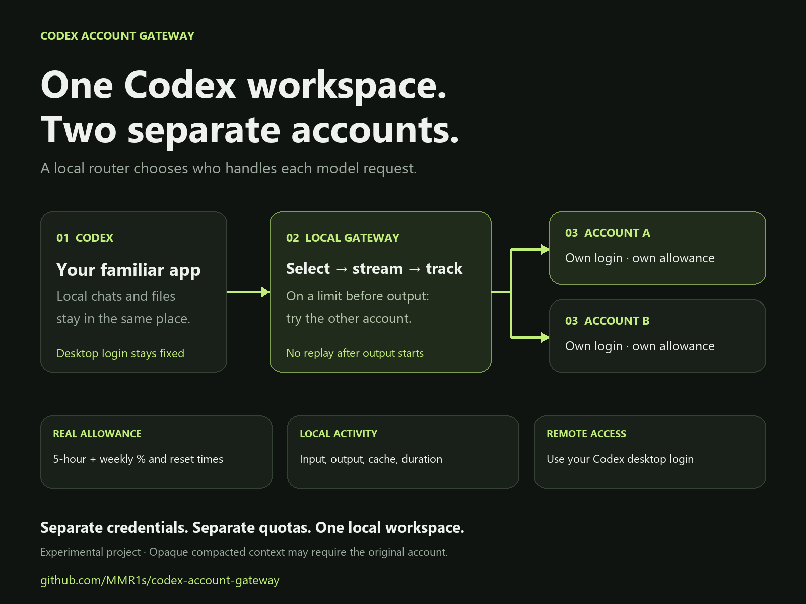

# Codex Account Gateway

A local, experimental gateway for two separately authenticated Codex subscription accounts. Keep your Codex workspace, inspect account allowance, and route a new request to the other account when the selected account reports a usage limit.



## Features

- Two isolated OAuth workers: separate credentials and token refresh per account.
- Transparent Responses streaming, tools, and account selection.
- Automatic failover on recognized allowance errors before output starts.
- Dashboard: selected account, actual reported five-hour/weekly percentage used and remaining, reset times, input/output/cached tokens, duration, outcomes, and account switches.
- SQLite activity survives restarts. It stores request metadata only, never prompts, response text, emails, or credentials.
- Identities are hidden in the dashboard by default for screenshots.
- Verification of both accounts before changing the Codex provider; original configuration backup and restore script.

## Windows installation

Requires Windows, Python 3.11 (including the `py` launcher), and Codex already installed and signed in. Choose a stable folder: Codex configuration references its absolute path.

```powershell
git clone https://github.com/MMR1s/codex-account-gateway.git
cd codex-account-gateway
powershell -NoProfile -ExecutionPolicy Bypass -File .\Setup.ps1
powershell -NoProfile -ExecutionPolicy Bypass -File '.\Start gateway.ps1'
```

Open http://127.0.0.1:4000/ in your browser. Connect two different accounts. Sign in only on `auth.openai.com`; device code login may need enabling in ChatGPT Settings > Security. Use a separate browser profile for the second account if needed.

Expand **Connections & Codex configuration**, then select **Verify accounts & configure Codex**. Verification consumes one short prompt per account. Restart Codex and start a new chat. The model comes from your existing Codex configuration; `CODEX_GATEWAY_MODEL` can override it before starting the gateway. Both accounts must have access to the selected model.

The Windows setup protects `.runtime/state` for the current user and SYSTEM. Dependencies live in `.runtime/venv`. Do not move or delete the folder after activation without restoring the provider first.

### Startup and restoration

For autostart, create a shortcut in your Windows Startup folder (`Win+R`, `shell:startup`) with target `"<repository>\.runtime\venv\Scripts\pythonw.exe" "<repository>\autostart.py"` and Start in set to the repository folder. The helper avoids launching a duplicate gateway. Keep the folder in place.

Run `Disable autostart.ps1` to remove the shortcut if you name it **Codex local account gateway**. Run `Stop gateway.ps1` to stop this installation. Run `Restore original provider.ps1`, then restart Codex, to restore the prior model/provider settings while preserving unrelated configuration changes.

## How requests move

1. Codex sends its full conversation input to the local gateway on port 4000.
2. The gateway selects a connected account that is not in cooldown.
3. A separate worker on port 4001 or 4002 authenticates and forwards the request to the subscription backend.
4. A recognized usage-limit error before output starts causes a cooldown and an attempt through the other account.
5. Output streams back to Codex; activity metadata is recorded locally.

The gateway is custom FastAPI routing with LiteLLM OAuth helpers, not the full LiteLLM proxy. Quota data is read from the subscription backend's usage endpoint once per minute. Percentages are not inferred from token totals. Unavailable or unsupported quota data is shown as unavailable, and window labels follow the actual reported duration.

Token counts cover only requests observed by this gateway since tracking began, including verification and retries. They are not lifetime account totals or a billing statement. Cached input and reasoning output are subsets of input and output. Requests without usage fields remain unmetered. The selected-account badge shows the last chosen account; recent activity identifies the account for each attempt. Successful routed streams include `X-Gateway-Account`.

## Workspace and remote access

Your local Codex chats, files, and workspace remain in the same place. The two credentials are separate; account quotas and cloud histories are not merged. The gateway does not store conversation content, although it forwards that content to the selected backend account for processing.

Remote connections use the account signed into the Codex desktop. Changing the gateway's model account does not change that desktop identity or set up remote access. Keep the PC online. See the [official remote connection documentation](https://learn.chatgpt.com/docs/remote-connections). Phone control together with subscription failover has not been verified end to end in this project.

## Compatibility and limits

This is an independent experiment, not an OpenAI product or endorsement. It uses subscription backend interfaces and pinned LiteLLM authentication helpers that can change. Use only accounts you are authorized to use; this does not combine allowances or grant extra entitlement.

- Full input is required: `previous_response_id` is rejected because server state can belong to another account.
- On an explicit encrypted reasoning rejection, the gateway retries after removing opaque reasoning, preserving ordinary messages and tool results. Account-bound compacted history cannot be transferred; a clear error asks you to continue on the original account or start a new chat with a saved summary.
- Output already started is never replayed through the other account, to avoid duplicate tool actions.
- A disconnected/expired account requires reconnecting. Exhausted accounts cool down; no guarantee that every backend limit is recognizable.
- Fixed loopback ports 4000/4001/4002. Do not expose them to the internet, LAN, or a tunnel. Dashboard administration relies on loopback, Host/Origin checks and a custom header. Other software running as your user can access local state.
- Windows is the supported installer platform. Other operating systems are not validated.

## Development and evidence

```powershell
.runtime\venv\Scripts\python.exe -m unittest discover -s tests
```

Automated routing tests cover HTTP/SSE limits, preserving tools and visible context, no replay after partial output, authorization, encrypted reasoning retry, compaction refusal, isolated credential paths, and configuration preservation. Telemetry tests cover quota redaction, unavailable data, durable token totals and closing SQLite connections.

Live checks completed: both accounts' streamed responses, real allowance snapshots, response token accounting, gateway tool-call round trip and Codex CLI through the custom provider. Deliberately exhausting subscriptions was not tested; failover is tested with mocked limit responses. Startup registration was checked on the original installation, but Windows logon launch was not tested.

## Privacy and security

Never publish `.runtime`, account auth files, key files, logs, databases, configuration backups, or model caches. `.gitignore` excludes these. Public assets contain no personal account data. See [SECURITY.md](SECURITY.md). MIT applies to this project's original code; dependencies keep their own licenses.
