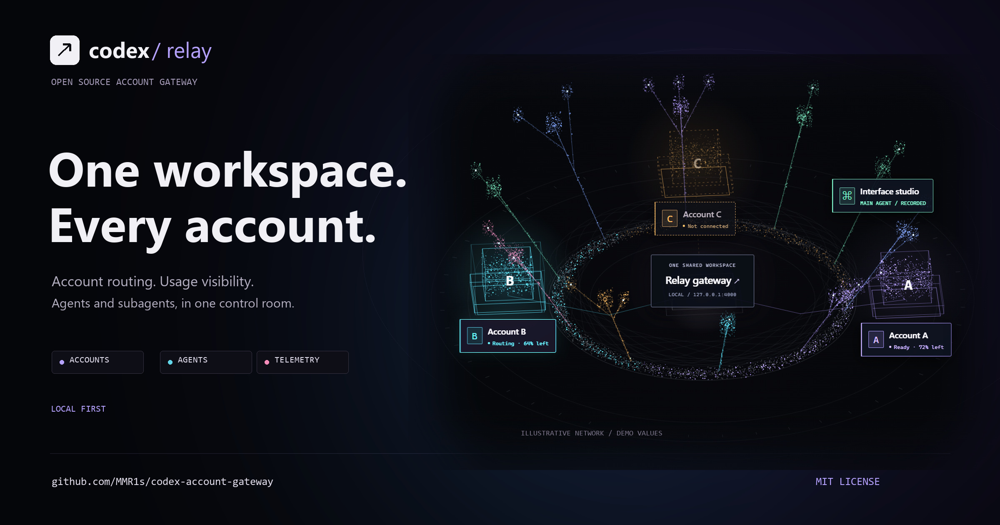

# Codex Relay



Connect multiple separately signed-in accounts to one Codex interface. The local gateway automatically tries another available account when it recognizes a usage limit before output starts. Your local chats, files, and projects stay in place.

**Codex Relay** is the dashboard for `codex-account-gateway`, an independent experimental project. Accounts provide access; agents are Codex tasks, and subagents are their delegated work. Credentials and account allowances remain separate. The cover uses demo identities and values.

[How it works](media/how-it-works.png) · [MIT license](LICENSE) · [Recording a demo](docs/demo.md)

## Features

- Connect up to 26 accounts through isolated OAuth workers.
- Automatically try another available account on a recognized usage limit before output or tools start.
- Choose the account for new requests with **Use this account**.
- See reported five-hour and weekly allowance, remaining percentages, and reset times.
- Explore recorded Codex agents and subagents, with lights for observed gateway requests.
- Inspect captured requests, token usage, timing, outcomes, charts, and CSV exports.
- Keep request metadata locally across restarts; conversation text is not stored in the activity ledger.
- Verify connected accounts before configuring Codex, with provider backup and restoration.

See [dashboard and data details](docs/dashboard.md) for navigation, capture scope, and live-activity limitations.

## Windows installation

Requires Windows, Python 3.11 (including the `py` launcher), and Codex already installed and signed in. Choose a stable folder: Codex configuration references its absolute path.

```powershell
git clone https://github.com/MMR1s/codex-account-gateway.git
cd codex-account-gateway
powershell -NoProfile -ExecutionPolicy Bypass -File .\Setup.ps1
powershell -NoProfile -ExecutionPolicy Bypass -File '.\Start gateway.ps1'
```

Open http://127.0.0.1:4000/ in your browser. Connect at least two different accounts. Use **Add account** for more desks (up to 26); each desk starts its own isolated worker. Sign in only on `auth.openai.com`; device code login may need enabling in ChatGPT Settings > Security. Use a separate browser profile for the second account if needed.

Open **Settings**, then select **Verify accounts & configure Codex**. Verification consumes one short prompt per account. Restart Codex and start a new chat. The model comes from your existing Codex configuration; `CODEX_GATEWAY_MODEL` can override it before starting the gateway. All connected accounts must have access to the selected model.

The Windows setup protects `.runtime/state` for the current user and SYSTEM. Dependencies live in `.runtime/venv`. Do not move or delete the folder after activation without restoring the provider first.

### Startup and restoration

For autostart, create a shortcut in your Windows Startup folder (`Win+R`, `shell:startup`) with target `"<repository>\.runtime\venv\Scripts\pythonw.exe" "<repository>\autostart.py"` and Start in set to the repository folder. The helper avoids launching a duplicate gateway. Keep the folder in place.

Run `Disable autostart.ps1` to remove the shortcut if you name it **Codex local account gateway**. Run `Stop gateway.ps1` to stop this installation. Run `Restore original provider.ps1`, then restart Codex, to restore the prior model/provider settings while preserving unrelated configuration changes.

## How requests move

1. Codex sends its full conversation input to the local gateway on port 4000.
2. The gateway selects a connected account that is not in cooldown.
3. A separate worker on its own port (4001–4026) authenticates and forwards the request to the subscription backend.
4. A recognized usage-limit error before output starts causes a cooldown and an attempt through another account.
5. Output streams back to Codex; activity metadata is recorded locally.

The gateway is custom FastAPI routing with LiteLLM OAuth helpers, not the full LiteLLM proxy. Quota data is read from the subscription backend's usage endpoint once per minute. Percentages are not inferred from token totals. Unavailable or unsupported quota data is shown as unavailable, and window labels follow the actual reported duration.

Token counts cover only requests observed by this gateway since tracking began, including verification and retries. They are not lifetime account totals or a billing statement. Cached input and reasoning output are subsets of input and output. Requests without usage fields remain unmetered. Existing chats can keep the provider selected when they were created, so restart Codex and start a new chat after configuring the gateway. The dashboard displays the capture scope and last captured request. In-progress requests are tracked separately from completed totals. The routing-account label shows the last chosen account; recent activity identifies the account for each attempt. Successful routed streams include `X-Gateway-Account`. The Agents page labels saved providers as **Gateway** or **OpenAI direct**: direct chats bypass the gateway even if another chat is capturing traffic.

### Usage-limit message after a switch

A chat already using the gateway continues through the selected account without restarting Codex or the gateway. If a backend reports a recognized limit before output begins, the router tries another account within the same request. Lifecycle metadata is held back so Codex does not see the rejected account's preliminary response. Subsequent tool turns use the newly selected account and retain the full visible input.

If Codex still shows “You've hit your usage limit”, check the chat's saved provider in **Agents**. An **OpenAI direct** chat sends requests outside the gateway and cannot use its fallback pool. Changing the default provider does not migrate that saved chat; start a gateway chat after the initial configuration reload. A restart is required for initial provider setup, not for each account switch. Errors after output or tool execution begins are still surfaced without replay, and unavailable accounts or account-bound compacted context can require user action.

## Workspace and remote access

Your local Codex chats, files, and workspace remain in the same place. Account credentials are separate; account quotas and cloud histories are not merged. The gateway does not store conversation content, although it forwards that content to the selected backend account for processing.

For remote work, use SSH to the machine running Codex and the gateway; your local workspace remains on that machine. SSH must be configured separately. This project does not configure a phone connection. The dashboard remains loopback-only. See the [official remote connection documentation](https://learn.chatgpt.com/docs/remote-connections) for supported Codex connection options.

## Compatibility and limits

This is an independent experiment, not an OpenAI product or endorsement. It uses subscription backend interfaces and pinned LiteLLM authentication helpers that can change. Use only accounts you are authorized to use; this does not combine allowances or grant extra entitlement.

- Full input is required: `previous_response_id` is rejected because server state can belong to another account.
- On an explicit encrypted reasoning rejection, the gateway retries after removing opaque reasoning, preserving ordinary messages and tool results. Account-bound compacted history cannot be transferred; a clear error asks you to continue on the original account or start a new chat with a saved summary.
- Output already started is never replayed through another account, to avoid duplicate tool actions.
- A disconnected/expired account requires reconnecting. Exhausted accounts cool down; no guarantee that every backend limit is recognizable.
- Router port 4000 and account worker ports 4001–4026, all loopback-only. Do not expose them to the internet, LAN, or an unauthenticated tunnel. Dashboard administration relies on loopback, Host/Origin checks and a custom header. Other software running as your user can access local state.
- Windows is the supported installer platform. Other operating systems are not validated.

## Development and evidence

```powershell
.runtime\venv\Scripts\python.exe -m unittest discover -s tests
```

Tests cover routing and failover, account persistence, telemetry privacy, local agent metadata, and configuration restoration. See [CONTRIBUTING.md](CONTRIBUTING.md) for checks and project layout.

Live checks completed: connected accounts' streamed responses, real allowance snapshots, response token accounting, gateway tool-call round trip and Codex CLI through the custom provider. Adding a third isolated worker and loading its desk were checked live. Authenticating a third subscription and deliberately exhausting subscriptions were not tested; failover through a third account is tested with mocked limit responses. Startup registration was checked on the original installation, but Windows logon launch was not tested.

## Privacy and security

Never publish `.runtime`, account auth files, key files, logs, databases, configuration backups, or model caches. `.gitignore` excludes these. Public assets contain no personal account data. See [SECURITY.md](SECURITY.md). MIT applies to this project's original code; dependencies keep their own licenses.
